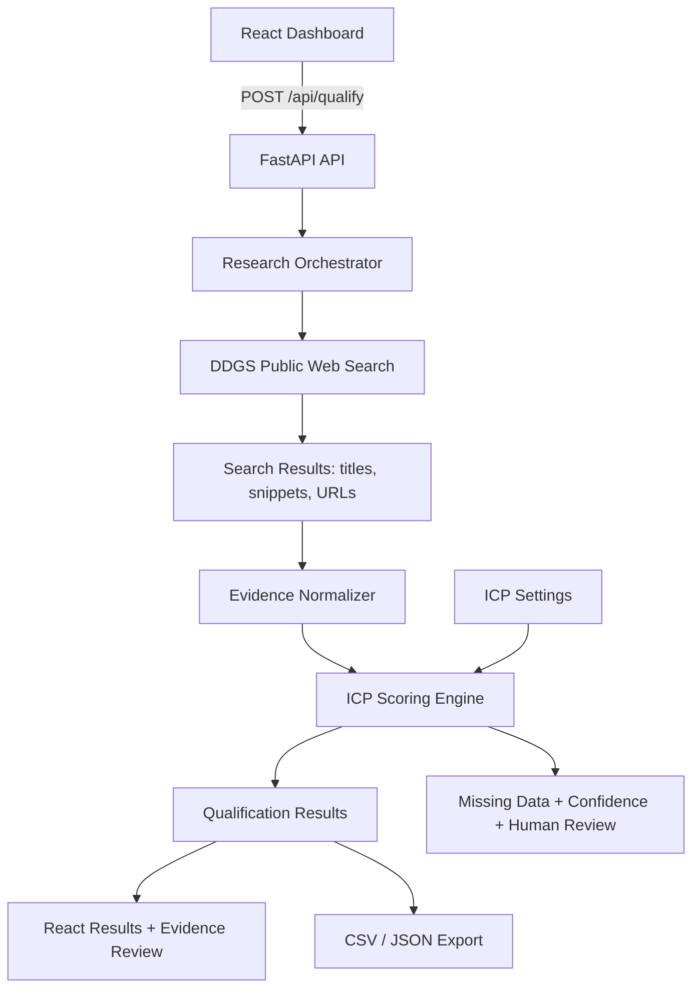

# Xdigics Agentic AI — B2B Lead Generation & Qualification

A full-stack internship-assessment prototype that researches companies through public web search, evaluates evidence against an Ideal Customer Profile (ICP), assigns an explainable fit score, and exports results as CSV/JSON. It is a shortlist-support tool, not a prediction of purchase intent.

## Features

- React + Vite dashboard with editable ICP, company list/CSV import, lead ranking, and evidence review.
- FastAPI backend with live public web search using the `ddgs` metasearch package.
- Transparent 100-point heuristic scoring, with per-factor rationale.
- Source URLs, snippets, domains, missing-data flags, confidence, and human-review indicator.
- CSV and JSON export endpoints.
- API input validation, capped batch size (25), conservative no-evidence behavior, and tests.
- No outbound email/message sending and no API key required for the base project.

## Architecture



## Scoring formula (maximum 100 points)

| Factor | Maximum | Rule |
|---|---:|---|
| Industry match | 25 | Search evidence contains a term for one of the target industries. |
| Service/need signals | 30 | 15 points for each matching requested service, capped at 30. |
| Geography match | 15 | Evidence contains a target geography signal. |
| Company size | 15 | Only awarded when a search snippet explicitly mentions an employee count; 10 points at/above the configured minimum, 15 at/above the ideal size. |
| Evidence coverage | 15 | 5 points per distinct source domain, capped at 15. |

Tier labels: **High fit** (70–100), **Potential fit** (40–69), **Low fit** (0–39), and **Needs research** (fewer than two source results). The app always requires human review. Search snippets are imperfect and may be stale; source pages must be opened and checked before acting on a lead. A score does not mean a company is ready to buy.

## Requirements

- Python 3.10+
- Node.js 20+ and npm
- Internet access for live public web search

## Run locally (macOS / Linux)

Open Terminal and move into the project folder.

### 1. Start the backend

```bash
cd backend
python3 -m venv .venv
source .venv/bin/activate
python -m pip install --upgrade pip
pip install -r requirements.txt
cp .env.example .env
uvicorn app.main:app --reload --host 127.0.0.1 --port 8000
```

Backend docs: http://127.0.0.1:8000/docs  
Health check: http://127.0.0.1:8000/api/health

### 2. Start the frontend in a second terminal

```bash
cd frontend
npm install
npm run dev
```

Open the Vite URL shown in Terminal, usually http://localhost:5173.

### 3. Demo

1. Leave the sample company names or enter up to 25 names (one per line).
2. Adjust industries, target geographies, services, and employee threshold to fit the consulting business.
3. Keep **Live public web research** enabled and click **Research & qualify leads**.
4. Select each result to inspect the score rationale, source URLs, snippets, and missing information.
5. Export CSV or JSON after the run.
6. For the assessment, demonstrate an incomplete/unfamiliar company name and explain why it receives a low-confidence / needs-research result.

### 4. Run tests

From the `backend` directory with its virtual environment active:

```bash
pytest -q
```

### 5. API usage example

```bash
curl -X POST http://127.0.0.1:8000/api/qualify \
  -H 'Content-Type: application/json' \
  -d '{"companies":["Example Cloud Co"],"research_live":true,"icp":{"target_industries":["SaaS","Technology"],"target_geographies":["India","United States"],"min_employee_count":50,"ideal_employee_count":500,"services":["cloud","data analytics","AI automation"]}}'
```

## Important limitations and guardrails

- Public metasearch can be rate-limited, blocked, or unavailable depending on provider/region. The UI surfaces warnings; retry or use a separately approved search API if needed.
- Evidence is search-result-level (title, snippet, URL); the current implementation does not claim to have independently verified every page's contents.
- Keyword scoring can miss context, infer too much from ambiguous language, and under-score companies whose snippets are sparse. Treat the score as a transparent prioritization heuristic.
- Company size and geography are not guessed when absent. Unknown fields are explicitly marked.
- The `confidence` field is a rough evidence-coverage indicator, not a calibrated probability.
- No outreach is performed. Use public information only, follow website terms and applicable privacy rules, and do not collect sensitive personal data.
- CSV/JSON export stores the most recent run in process memory. Restarting the backend clears it; use a database for persistent multi-user production use.
- CORS is configured for local Vite development. Restrict origins and add authentication before deployment.

## Project structure

```text
xdigics-lead-qualifier/
├── README.md
├── .gitignore
├── backend/
│   ├── requirements.txt
│   ├── .env.example
│   ├── app/
│   │   ├── main.py
│   │   ├── models.py
│   │   ├── research.py
│   │   └── scoring.py
│   └── tests/
│       ├── test_api.py
│       └── test_scoring.py
└── frontend/
    ├── package.json
    ├── index.html
    └── src/
        ├── main.jsx
        ├── App.jsx
        └── styles.css
```

## Documentation references

- FastAPI first steps: https://fastapi.tiangolo.com/tutorial/first-steps/
- DDGS package and text search: https://github.com/deedy5/ddgs
- React + Vite starting point: https://react.dev/learn/build-a-react-app-from-scratch
